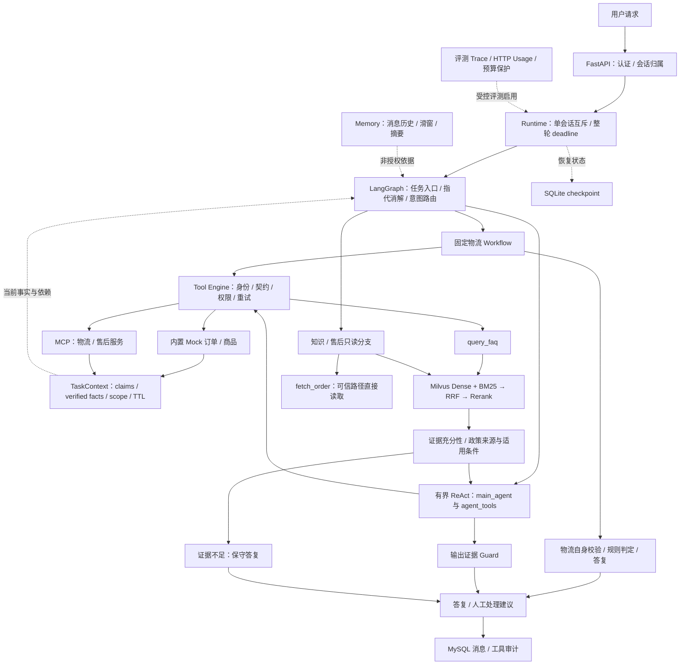

# EcomCare Agent｜电商智能客服 Agent

**基于 LangGraph 的电商客服智能体与可靠性增强。** 面向订单物流调查、知识问答和售后条件说明，重点处理多轮换单后的事实复用、工具执行约束及用量可观察性。

项目基于购买的 **MewHelp《AI Agent 智能客服实战》课程项目二次开发**，原代码标注作者为「小林coding」。课程已提供 Workflow/ReAct、RAG、MCP、Memory 与观测框架；本人在此基础上扩展和验证工程约束，使用 Codex 辅助实现、审查和测试。源码公开许可已由项目持有者向课程作者确认；保留原署名，不宣称从零开发。[来源与公开范围](COPYRIGHT.md) · [二次开发贡献](docs/contributions.md)。

## 项目解决的问题

- **订单物流调查：**核验订单归属，再读取物流证据，区分正常、停滞及签收争议；缺少订单号先澄清，当前只给调查结果或人工处理建议。
- **多轮事实管理：**用户陈述、历史摘要和工具核验事实分离；事实绑定用户、会话、任务、订单及 TTL，换单或复核失败时旧依赖失效。
- **受约束工具调用：**模型可以提出工具请求，服务端负责身份、允许表、参数与返回契约、只读重试及整轮 deadline。
- **可追溯评测：**Graph/Tool Trace 与供应商 HTTP Usage 分层统计；业务评分、保护审计、未知费用分别报告。

订单、商品与物流均为 **Mock 数据**；退款、真实工单写入关闭。项目可本地运行，不代表已经生产上线或完成通用防注入验证。

## 架构



物流走固定业务 Workflow；业务问答可进入 ReAct 工具循环；知识分支先检索再生成。所有路径并非共用一个 Guard，`fetch_order` 也不是经 Tool Engine 读取。[架构与源码导航](docs/architecture.md)。

**核心技术：**Python 3.12、FastAPI/Pydantic、LangGraph/LangChain、MCP、Milvus、MySQL/SQLAlchemy、SQLite、HTTPX、Docker。

## 三项二次开发重点

| 工程问题 | 实现 | 代码入口 |
| --- | --- | --- |
| 换单后旧物流事实污染判断 | 事实来源与 scope/TTL、依赖撤销、失败刷新失效 | [TaskContext](app/graph/task_context.py) |
| 模型调用工具缺少业务约束 | 服务端身份注入、MCP 本地允许表、输入输出契约、deadline / 取消 | [工具引擎](app/tools/engine.py)、[注册表](app/tools/registry.py)、[Runtime](app/graph/runtime.py) |
| 成本与成功率观察不可信 | 请求级 Usage、未知保留、跨流状态隔离、缺测停止及离线回放 | [Usage](app/evaluation/usage_meter.py)、[费用闸](app/evaluation/money_guard.py)、[流式封装](app/core/llm.py) |

政策版本、审批、正文哈希及适用条件检查属于额外约束，不等于任意政策资格或自然语言断言都已证明。[贡献与验证边界](docs/contributions.md)。

## Windows 快速开始

推荐 Windows + VSCode + WSL（Ubuntu）+ Docker Desktop，WSL 启用 Docker 集成。Python 3.12 和 uv 已安装时，在仓库根目录的 WSL 终端执行：

```bash
uv sync --locked --group dev --no-group ml
uv run --locked python scripts/init_local_env.py
export PYTHONPATH="$PWD"
```

脚本仅创建新的 `.env`，生成随机本地数据库/MinIO 凭据，不覆盖已有配置。私下填入 `CHAT_API_KEY`、`EMBED_API_KEY`、`RERANK_API_KEY`，确认模型和服务可用。模板不含真实密钥。

```bash
docker compose up -d
docker compose ps
uv run --locked python scripts/build_kb.py
```

等待容器健康。`build_kb.py` 只把仓库自写的合成知识切块写入本地 MySQL。下一步**会调用嵌入 API，可能收费，操作者确认后手动执行**：

```bash
uv run --locked python scripts/vectorize_kb.py
```

准备好知识索引后，在同一个终端启动：

```bash
uv run --locked python scripts/init_demo_auth.py
export MEWHELP_FIXTURE_PROFILE=task-v1
uv run --locked python scripts/run_local_agent.py --env-file "$PWD/.env"
```

打开 <http://127.0.0.1:8000>，使用初始化时生成的合成账号密码登录；主动发送问题会调用真实模型。Ctrl+C 只关闭本次 API/MCP，保留数据容器。当前保持 **1 worker**。

PowerShell 原生环境的等价命令、端口和排障见 [运行文档](docs/running.md)。本轮验证了实际 API/MCP 启动及本机已有依赖，未把它描述成全新 Docker 数据卷或 Windows 原生服务验收。

## 演示与测试

演示输入：正常物流、异常调查、多轮换单、无权请求与工具异常处理，见 [演示说明](docs/demo.md)。[静态证据页](demo/index.html)是历史/离线摘要，不是真实聊天界面，也不调用模型。

零外部请求回归：

```bash
uv run --locked --group dev --no-group ml python -B scripts/check_agent_core.py --tests-only --compatible-course
```

这是指定的离线套件，禁止网络、业务数据库、`.env` 和旧留出标签读取。不要直接把课程完整 `pytest` 指向日常数据库；部分历史测试会重建测试库，部分旧写入契约与当前只读模式不同。

| 实验 / 验证 | 结果与解释 |
| --- | --- |
| 历史真实模型 + Mock 业务 | 12 个冻结合成任务 / 13 轮业务 PASS 12；**当时预算保护审计失败**，不能称完整合规 Baseline 或生产准确率 |
| 缺 Usage 后停止的离线回放 | 61 条观察；第 14 条缺测后 47 次后续发送被阻止；不是原始响应字节重放 |
| 本次公开版离线回归 | 446 passed、1 skipped、25 subtests passed；包含 4 项无旧 Git 历史的来源快照回归 |

最新 Usage 修复未做新的在线端到端验收。公开版采用新写的合成知识材料，不把历史知识条件下的结果移植为公开版成绩。[评测口径](docs/evaluation.md) · [本轮发布验证](docs/release-validation.md)。

## 目录

```text
app/                 FastAPI、Graph、Memory、Tool、RAG、Evaluation
mcp_servers/         实际物流/售后 MCP 服务
scripts/             启动、建库、离线回归与显式在线评测入口
tests/               原工程测试与新增安全/Usage回归
data/                自写合成知识、业务Fixture与实验定义
sql/                 课程数据库结构与自写演示种子
docs/                部署、架构、贡献、演示、评测边界
provenance/          不携带旧Git历史的课程Prompt来源快照
```

## 当前限制与来源

真实工单/退款、生产容量、多实例恢复、正式政策资格和未见样本泛化未验收。当前会话互斥为单进程实现；评测金额闸不等于手动聊天入口金额封顶。免费 Rerank 若不提供 Usage，严格评测应停止，不能把未知 Token 填成 0。

原代码保留课程作者来源注释；第三方框架按各自许可证使用。本仓库没有替课程源码擅自添加 MIT / Apache 再许可。[版权及公开说明](COPYRIGHT.md) · [第三方组件](THIRD-PARTY-NOTICES.md)。
